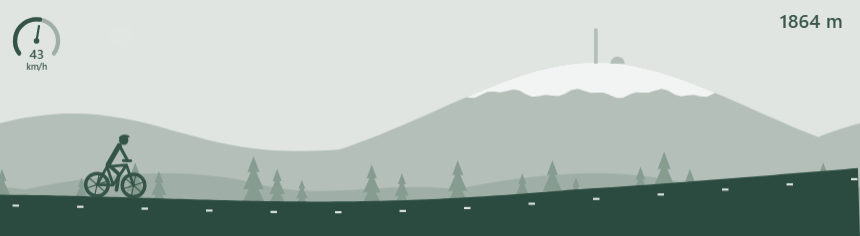

# Brocken Race

A small endless runner on canvas: a mountain biker rides through the Harz mountains in Germany, jumps over rocks, bushes, young firs, benches, wild boars and wolves, ducks under buzzards and owls, and climbs all the way up to the snowy summit of the Brocken.

**[Play it in the browser](https://locorida.github.io/brocken-race/#play)** · German and English · keyboard, mouse and touch

## Features

- **Plain JavaScript, no dependencies.** One script (`bike-game.js`, about 1000 lines) draws everything on a `<canvas>`: parallax mountains, forest, terrain, rider, animals, snow and confetti. No images, no build step.
- **Gets harder over time.** The base speed rises for about a minute and then keeps creeping up, obstacles come closer together, and the terrain rolls: faster downhill, slower uphill. Every 650 m there is a big climb followed by a steep descent with an extra boost, and the camera follows the hill.
- **A stage goal.** At 2000 m the rider reaches the Brocken summit, with snow, transmitter mast and summit stone, and gets confetti. Then the ride goes on, downhill towards Schierke. The massif grows on the horizon long before you get there.
- **Day and night.** Night falls on a fixed rhythm (owls instead of buzzards, stars). If your system uses a dark colour scheme, the ride starts at night.
- **Accessible where it can be.** Native `<dialog>` (focus handling, Esc to close), keyboard controls, 44 px close button, and an `aria-live` region that announces start, crashes, the summit and your record. The help text adapts to touch devices.
- **Speedometer and record.** A small speedo in the corner, best distance saved in `localStorage` (optional; the game works without it).

## Controls

| Action | Keyboard | Touch / mouse |
|---|---|---|
| Jump | Space, ↑ or W | Tap / click |
| Duck | Hold ↓ or S | Swipe down |

## Tested balance

Fast endless runners easily become unfair: an obstacle can show up where no jump timing works. Two Node scripts check the real game code (they load `bike-game.js` with a stubbed DOM, see `sim/harness.js`):

- **`npm test`: fairness simulation** (`sim/fairness.js`). For every speed level, many points on the terrain (rolling hills, the big climbs and descents, the Brocken) and every obstacle type, it tries every possible take-off point and measures the jump window in milliseconds. It also checks the second of two obstacles at the minimum spacing the spawner can produce. The run fails if any window is shorter than **125 ms**. Desktop and phone width are checked separately, because the phone version is narrower and slower. Takes about ten minutes per screen width; it runs on every push via GitHub Actions.
- **`npm run bot`: bot simulation** (`sim/bot.js`). A bot plays the real game with human-like timing errors, reaction time and occasional lapses, for three player types. This is how the stage goal was placed at 2000 m: about 6 % of casual players, about 60 % of average players and about 90 % of practised players get there.

Requires Node 18 or newer, no `npm install` needed.

## Run locally

Open `index.html` in a browser. `index.html#play` opens the game directly, `?lang=de` or `?lang=en` picks the language (otherwise the browser language decides).

## Embedding

The game expects a `<dialog id="bike-game">` with a canvas, a close button and a status line; see `index.html` for the markup, styles and texts. Load `bike-game.js` (it can be loaded lazily on first click) and call `window.BikeGame.open()`.

## License

[MIT](LICENSE)
